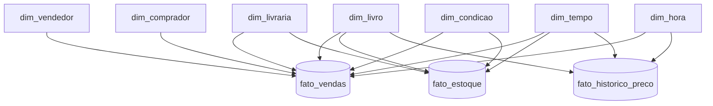

# Modelagem Dimensional – Rede de Livrarias

## 1. Visão geral

O projeto utiliza uma modelagem multidimensional baseada em uma constelação de fatos, composta por sete tabelas dimensionais e três tabelas de fatos.

O modelo foi desenvolvido para armazenar informações sobre vendas, entradas de estoque e histórico de preços de uma rede fictícia de livrarias.

A estrutura permite realizar consultas analíticas relacionadas ao desempenho comercial, à movimentação de estoque e às alterações nos preços dos livros.

## 2. Tabelas dimensionais

As dimensões armazenam informações descritivas que permitem contextualizar os registros das tabelas de fatos.

| Dimensão | Finalidade |
|---|---|
| `dim_livro` | Armazena título, autores, editora e ano de publicação dos livros. |
| `dim_livraria` | Armazena nome, endereço e localização das livrarias. |
| `dim_vendedor` | Armazena nome, CPF e idade dos vendedores. |
| `dim_comprador` | Armazena nome, CPF e idade dos compradores. |
| `dim_tempo` | Armazena a data, dia, mês, trimestre, ano e dia da semana. |
| `dim_hora` | Armazena o horário e seus componentes de hora e minuto. |
| `dim_condicao` | Identifica a condição do livro: novo ou usado. |

## 3. Tabelas de fatos

As tabelas de fatos armazenam os eventos e as medidas que serão utilizadas nas análises.

### 3.1. fato_vendas

Registra os itens comercializados pelas livrarias.

**Granularidade:** cada registro representa um item de uma venda.

Principais informações:
- Livro comercializado;
- Livraria onde ocorreu a venda;
- Vendedor responsável, quando houver;
- Comprador;
- Data e horário;
- Condição do livro;
- Quantidade;
- Preço unitário;
- Desconto;
- Valor total.

O campo `codigo_venda` permite agrupar diferentes itens pertencentes à mesma compra.

O campo `vendedor_id` aceita valor nulo, permitindo registrar vendas realizadas sem intermédio de um vendedor.

### 3.2. fato_estoque

Registra as entradas de livros no estoque das livrarias.

**Granularidade:** cada registro representa uma entrada de estoque de determinado livro em uma livraria, em uma data e condição específicas.

Principais informações:
- Livro;
- Livraria;
- Data da entrada;
- Condição do livro;
- Quantidade recebida;
- Custo de aquisição.

### 3.3. fato_historico_preco

Registra as alterações nos preços dos livros.

**Granularidade:** cada registro representa um evento de alteração ou registro de preço de determinado livro.

Principais informações:
- Livro;
- Data da alteração;
- Horário da alteração;
- Preço anterior;
- Novo preço.

Quando não existe um preço anterior registrado, esse campo pode permanecer nulo.

## 4. Relacionamentos do modelo

As tabelas de fatos utilizam chaves estrangeiras para se relacionar com as dimensões.

- `fato_vendas` relaciona-se com livro, livraria, vendedor, comprador, tempo, hora e condição.
- `fato_estoque` relaciona-se com livro, livraria, tempo e condição.
- `fato_historico_preco` relaciona-se com livro, tempo e hora.

O relacionamento com vendedor em `fato_vendas` é opcional, pois uma venda pode ocorrer sem vendedor identificado.

## 5. Diagrama multidimensional

O diagrama abaixo representa a organização das dimensões e das tabelas de fatos.

## 6. Análises atendidas pelo modelo

A estrutura permite desenvolver consultas para:

1. Identificar os livros mais e menos vendidos.
2. Analisar os preços praticados e as localidades das vendas.
3. Comparar o desempenho dos vendedores.
4. Identificar as livrarias com maior e menor volume de vendas.
5. Consultar o histórico de alterações de preços.
6. Analisar o histórico de vendas por vendedor.
7. Analisar o histórico de vendas por livraria e localidade.

## 7. Considerações

O modelo foi implementado no PostgreSQL 18 utilizando chaves primárias, chaves estrangeiras e restrições para manter a integridade dos dados.

A tabela `fato_estoque` registra entradas de estoque. Ela não representa, isoladamente, um saldo atualizado de estoque disponível.

A tabela `fato_historico_preco` registra o histórico de preços por livro, enquanto `fato_vendas` preserva o preço efetivamente praticado em cada item vendido.

---

**Projeto:** Data Warehouse – Rede de Livrarias  
**Disciplina:** Engenharia de Dados  
**SGBD:** PostgreSQL 18